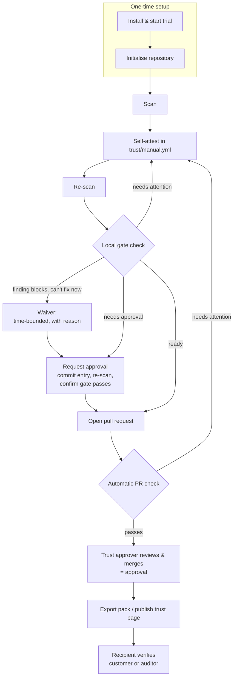

# How you use AI TrustBOM

This is the end-to-end workflow at a glance. Each step links to the
[CLI reference](cli-reference.md) for commands and options, and the
[tutorial](tutorial.md) walks through it hands-on.

**Who is involved:** your developers, your Trust approver (the person
authorised to sign off for your company) and the recipients of your disclosure
(your customers or auditors).

## 1. Get set up (once)

- Install the `trustbom` command-line tool.
- Start a free 30-day trial, or activate your subscription key.
- Run `trustbom init` in your repository. It adds the folders, review rules
  and automatic pull-request checks.

See [install](cli-reference.md#1-install-the-cli),
[initialize](cli-reference.md#2-initialize-a-repository) and
[licensing](licensing.md).

## 2. Scan

- Run `trustbom scan`. It finds the AI models, tools and services your
  software uses.
- It produces your AI disclosure (the "trust card") and a questionnaire.

See [scan](cli-reference.md#3-scan-the-repository).

## 3. Self-attest what the scan can't see

- Edit `trust/manual.yml` to declare things that repository evidence can't
  show:
  - AI models or tools the scan can't detect;
  - third-party providers (subprocessors);
  - how data is handled, such as prompt retention, training use and deletion;
  - your own judgements, with reasons.
- Your declarations take precedence over scanned values and are marked as
  self-attested. Anything you don't declare stays "unknown".
- Re-run `trustbom scan` to include them.

See [manual declarations](manual-declarations.md).

## 4. Check locally

- Run `trustbom gate`. It explains in plain language what would block your
  change and how to resolve it.
- Depending on the result:
  - **Needs attention:** fix the issue or add a declaration (step 3), then
    re-scan.
  - **A finding can't be fixed now:** add a waiver (step 5).
  - **Needs approval:** request approval (step 6).
  - **Ready:** open a pull request (step 7).

See [evaluate the gate](cli-reference.md#4-evaluate-the-gate-locally).

## 5. Waive a finding (optional)

- Add a time-bounded waiver, with a reason, to the approval file. It covers
  that specific finding until an expiry date.
- Your Trust approver reviews waivers with the rest of the approval. When the
  date passes, the finding blocks again.

## 6. Request approval

- Run `trustbom request-approval`. It prepares the approval entry for your
  Trust approver. Commit it.
- Re-scan to refresh your files, then run the local gate again to confirm it's
  ready.

See [approve a graph](cli-reference.md#5-approve-a-graph-in-git).

## 7. Open a pull request

- The automatic check runs the same gate and comments on the pull request.
- If it needs attention, go back to step 3.

See [the GitHub Action](github-action.md).

## 8. Trust approver reviews and merges

- A Trust approver other than the author reviews the change and approval
  entry, then merges. The merge is the approval, recorded in your normal Git
  history.

## 9. Share your disclosure

- `trustbom export` produces the approved disclosure pack: summary,
  questionnaire answers and an integrity manifest. Add `--format cyclonedx`
  for a CycloneDX BOM.
- `trustbom publish` produces a ready-to-host trust web page.
- Optionally, `trustbom readiness` gives an advisory view of evidence gaps.

See [export](cli-reference.md#6-export-a-customer-facing-pack),
[approved export](approved-export.md), [trust page](trust-page.md) and
[readiness](cli-reference.md#8-review-advisory-evidence-readiness).

## 10. Recipient verifies

- Whoever receives your pack, such as your customer or an auditor, runs
  `trustbom verify`. It's free and works offline. It confirms the pack hasn't
  been altered since you approved it.

See [pack verification](pack-verification.md).
