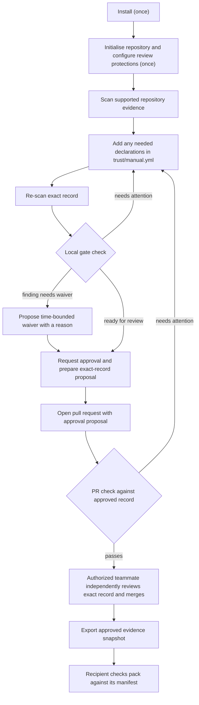

# How you use AI TrustBOM

This is the end-to-end workflow at a glance. Each step links to the
[CLI reference](cli/README.md) for commands and options, and the
[tutorial](tutorial/README.md) walks through it hands-on.

**Who is involved:** your developers, an existing team member authorized to
review and approve the record (the **Trust approver**), and recipients such
as customers or auditors. This is a responsibility, not a new hire or
department.

## 1. Get set up (once)

- Install the `trustbom` command-line tool.
- Run `trustbom init` in your repository. It adds the folders, review rules
  and pull-request workflow. Configure the required status check and branch
  protections separately if a failing check must block merging.
- Scanning, review, gating and `export --draft` are free and do not require a
  trial. Start a trial or activate a subscription when you need paid
  operations.

See [install](installing.md),
[initialize](cli/init.md) and
[licensing](licensing.md).

## 2. Scan

- Run `trustbom scan`. Bounded detector packs inspect supported tracked
  manifests, lockfiles, allowlisted configuration and patterns for cited
  signals. This is not exhaustive discovery or runtime monitoring.
- It produces your AI disclosure (the "trust card") and a questionnaire.

See [scan](cli/scan.md).

## 3. Declare what repository evidence cannot establish

- Edit `trust/manual.yml` to declare things that repository evidence can't
  show:
  - AI models or tools the scan can't detect;
  - third-party providers (subprocessors);
  - how data is handled, such as prompt retention, training use and deletion;
  - your own judgements, with reasons.
- Your declarations take precedence over scanned values and are marked as
  manual, with their provenance retained. Anything unsupported stays
  "unknown"; the scan does not infer a negative claim from missing evidence.
- Re-run `trustbom scan` to include them.

See [manual declarations](manual-declarations.md).

## 4. Check locally

- Run `trustbom gate`. It explains in plain language what would block your
  change and how to resolve it.
- Depending on the result:
  - **Needs attention:** fix the issue or add a declaration (step 3), then
    re-scan.
  - **A finding can't be fixed now:** add a waiver (step 5).
  - **Needs approval:** request approval (step 6).
  - **Ready:** open a pull request (step 7).

See [evaluate the gate](cli/gate.md).

## 5. Waive a finding (optional)

- Add a time-bounded waiver, with a reason, to the approval file. It covers
  that specific finding until an expiry date.
- Your authorized reviewer reviews waivers with the rest of the approval. When the
  date passes, the finding blocks again.

## 6. Request approval

- Run `trustbom request-approval`. It prepares the approval entry for your
  authorized reviewer; the entry binds to the exact graph fingerprint.
- Re-scan to refresh your files, then run the local gate again to confirm it's
  ready.
- Commit the approval entry with the rescanned `trust/card.json` and
  `trust/card.md` in the approval pull request:
  `git add trust/approvals.yml trust/card.json trust/card.md`. Export reads
  `trust/card.json` beside the approval, so it must be committed and not
  ignored by `.gitignore` (only `export/` should be ignored).

See [approve a graph](cli/request-approval.md#approve-a-graph-in-git).

The `approved_by` and `approved_at` values in `trust/approvals.yml` are
declared metadata. The independent GitHub review and merge history is the
authoritative evidence of who reviewed the change.

## 7. Open a pull request

- The generated workflow runs the gate and comments on the pull request.
  Require its status check and configure branch protections if a failing
  gate must prevent merging; a workflow or CODEOWNERS file alone does not
  enforce that.
- If it needs attention, go back to step 3.

See [the GitHub Action](github-action.md).

## 8. Trust approver reviews and merges

- An existing team member authorized to approve, other than the author,
  independently reviews the exact record and approval entry, then merges.
  GitHub review and merge history records that action; the YAML approver
  fields are declarations, not proof of the review.

## 9. Share your disclosure

- Paid `trustbom export` produces a snapshot of the approved record:
  summary, questionnaire answers and an integrity manifest. Add
  `--format cyclonedx` for a CycloneDX BOM. `export --draft` is free and
  watermarked as unapproved.
- Paid `trustbom publish` produces a static HTML and PDF pack.
- Optionally, `trustbom readiness` gives an advisory view of evidence gaps.
- Previously shared packs do not update when the record changes.

See [export](cli/export.md),
[approved export](approved-export.md), [trust page](trust-page.md) and
[readiness](cli/readiness.md).

## 10. Recipient verifies

- Whoever receives your pack can run `trustbom verify`. It's free and works
  offline; it checks that the files match the supplied manifest. By itself,
  this does not authenticate origin or prove that the pack was approved.
  `--repo` can compare manifest approval fields with the vendor's Git history;
  origin still requires independent review evidence, a trusted delivery
  channel or a verified signature.

See [pack verification](pack-verification.md).
